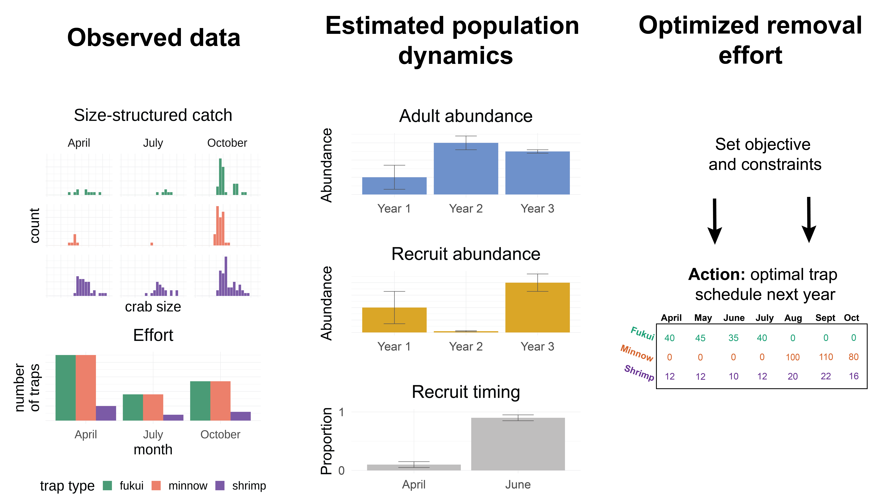

# European Green Crab Decision Support Tool

This repository contains code underlying the `European Green Crab Decision Support Tool`, built in collaboration with USGS Western Fisheries Research Center.

The current deployment of the app can be found at [egc-decision-support.nrp-nautilus.io](egc-decision-support.nrp-nautilus.io).